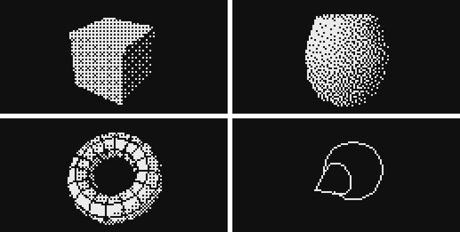

# Third Dimension

A small 3D renderer for 32-bit microcontrollers, as an Arduino and PlatformIO library. You put
objects in a scene, built-in shapes or models converted from OBJ files, and it draws them on a
small display (a 1-bit OLED, an RGB565 framebuffer, anything you can plot a pixel on).

See it running at https://dangelo.engineering (the ship in a bottle there is drawn with it).



## Install

- **Arduino IDE:** download this repository as a ZIP, then Sketch > Include Library > Add .ZIP Library.
- **PlatformIO:** `lib_deps = https://github.com/dangelo729/third_dimension.git`

It needs a 32-bit board with hardware floating point; its examples are built for Teensy 4.1,
ESP32 and Raspberry Pi Pico 2 (RP2350). On AVR it stops with a compile error.
`<ThirdDimension.h>` uses no other library.
`<ThirdDimension_GFX.h>`, for Adafruit_GFX displays, needs the Adafruit GFX Library, which is not
installed for you: add it and your display's driver (here Adafruit SSD1306) yourself.

## Use

```cpp
#include <Adafruit_SSD1306.h>
#include <ThirdDimension_GFX.h>

Adafruit_SSD1306 display(128, 64, &Wire, -1);  // an I2C panel, no reset pin
TD_GFXMonoTarget target(display);  // dithers onto any 1-bit GFX display
TD_BoxMesh cubeMesh;               // a unit cube, built in RAM
TD_Object cube(cubeMesh);
TD_Scene scene;                    // camera and light included

void setup() {
  display.begin(SSD1306_SWITCHCAPVCC, 0x3C);
  scene.add(cube);
}

void loop() {
  cube.setRotation(-0.5f, millis() * 0.0008f, 0.0f);  // radians: tilt, spin
  scene.render(target);  // transform, sort, shade, dither, plot
  display.display();     // push the frame to the panel
}
```

This is `examples/SpinningCube`. The camera frames the scene at its first render and the key
light shines from the upper left, so nothing more is needed. An object added later is not
framed until `scene.camera.refit()`. The main calls:

- **Meshes:** `TD_BoxMesh`, `TD_SphereMesh`, `TD_EllipsoidMesh`, `TD_CylinderMesh`, `TD_ConeMesh`,
  `TD_PrismMesh`, `TD_TorusMesh`, `TD_PlaneMesh`, or a header made by `tools/obj2mesh.py`. A
  built-in shape that could not be built (no memory, a size of zero) draws nothing, and its
  `valid()` is false.
- **Objects:** `setPosition(x, y, z)`, `setRotation(rx, ry, rz)`, `setScale(s)`, `setColor(rgb565)`,
  `setMaterial(TD_MATERIAL_WHITE)`, `setVisible(false)`; `scene.add(obj)`, `scene.remove(obj)`.
- **Camera and light:** `scene.camera.setOrbit(azimuth, elevation)`, `setTarget(x, y, z)` and
  `fitRadius(r)` to frame moving objects, `setFov(degrees)`; `scene.light.setDirection(azimuth,
  elevation)`, `scene.addLight(light)`, `scene.setAmbient(a)`.
- **Targets:** `TD_GFXMonoTarget(display)`, `TD_MonoTarget(plot, user, w, h)` for a pixel callback,
  `TD_Color565Target(buffer, w, h)` for an RGB565 framebuffer, or your own `TD_RenderTarget`.
- **Rendering:** `scene.render(target)` returns false when it cannot draw, with the reason in
  `scene.lastStatus()` and the target untouched; `scene.renderer().reserve(verts, faces,
  objects)` in `setup()` takes its memory up front.

Angles are radians, except `setFov`, which takes degrees. `scene.setRenderMode(...)` picks the
look: `TD_SHADED` (the default: lit, dithered on a 1-bit target), `TD_SOLID` (flat fills, dark
edges), `TD_WIREFRAME`, `TD_CEL` (light in flat bands, with ink) or `TD_OUTLINE` (silhouettes and
creases only, hidden lines removed). On a 1-bit target `target.setDither(...)` picks one of ten
dither methods.

## Examples

- `SpinningCube`: the sketch above.
- `PrimitivesTour`: the eight built-in shapes on a turning ring.
- `SolarSystem`: a sun and two planets sharing one mesh, passing in front of each other.
- `ImportedModel`: a model converted from OBJ; a button cycles the dither methods.
- `DitherGallery`: the ten dither methods in turn.
- `CelGallery`: cel shading's band counts, ink styles and dithers.
- `OutlineGallery`: outline rendering: the shapes, a crease-angle sweep, hidden lines.
- `ColorCube_SSD1331`: a cube drawn in color into an RGB565 framebuffer for a color OLED.
- `CustomTarget_NoGFX`: no display library at all: a pixel callback, printed over Serial.

## Tools

`tools/obj2mesh.py` turns an OBJ file into a mesh header. `tools/editor.html`, opened in a
browser, builds a model from the eight shapes and exports the same kind of header.

## Tests

```sh
make -C test/host run
```

## More

[Render modes, dithering and lights](extras/docs/render-modes.md) ·
[Render targets](extras/docs/render-targets.md) · [Bringing in models](extras/docs/asset-pipeline.md) ·
[Coordinate conventions](extras/docs/conventions.md) · [Limits and memory](extras/docs/limits.md) ·
[How a frame is made](extras/docs/architecture.md) · [Changelog](CHANGELOG.md)

## License

MIT, see [LICENSE](LICENSE).
